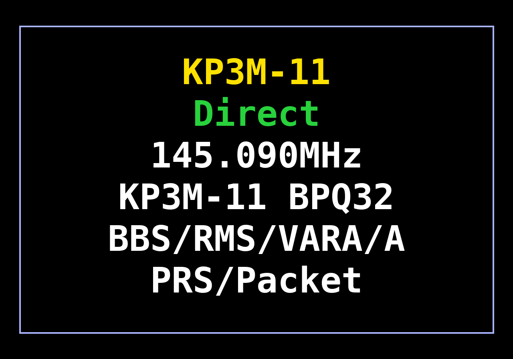

# Receive-AT-D878UV — analog APRS receive for the AnyTone AT-D878UV



If you have an AnyTone AT-D878UV **without** the Bluetooth / APRS option, you already
know it can transmit analog APRS but it cannot receive it. This firmware changes that.
It adds analog APRS **receive** (1200-baud AFSK, the normal VHF APRS) to the plain
D878UV, decodes the packets right on the radio, and shows them on the screen — who sent
it, whether it came in direct or through a digipeater, and the message text, in color.

No extra hardware, no board swap, no soldering — it is just a firmware flash. It runs
alongside normal radio use: voice and your analog channels work exactly as before.

It is still a work in progress, but it is decoding real packets off the air today.

— KP3M

## What it does

- Receives and decodes analog APRS (AFSK1200 / AX.25) on **any analog channel or VFO**.
- Pops up each received packet for about 3.5 seconds, color coded:
  - **Sender callsign** — yellow
  - **Direct** (green) or **Via** (red) + the **digipeater** that repeated it (yellow)
  - **Message / comment** — white
- Cleans up the text: the timestamp and GPS coordinates are stripped from position
  reports, so you just see the station's message.
- A newer packet replaces the one on screen right away.

## Tested on

Tested on an AT-D878UV running **firmware 4.00**. It is built from the 4.00 image, so
4.00 is what it is verified against. It should work on earlier versions as well, but
those have not been tested yet — testers welcome (see below).

## What it was built for

This runs on the radio's own processor — a **GD32F303 (ARM Cortex-M4)** on the D878UV
main board (pictured in `images/board.jpg`). The whole receive chain — sampling the
audio, demodulating AFSK1200, framing AX.25 and checking the CRC — runs on that chip,
with no added hardware.

## Release

**Version 4.0a — alpha.** This is an early test release. Expect rough edges.

## Flashing

> **IMPORTANT — BACK UP YOUR CODEPLUG FIRST.** Before you flash anything, read your
> codeplug out of the radio with the CPS and save it. Flashing has not erased the
> codeplug in testing, but always keep a backup so you can restore your channels and
> settings if anything goes wrong.

The firmware files are in [`firmware/`](firmware/). Load it the same way you load any
AnyTone firmware update.

1. **Back up your codeplug first** with the CPS (this process is not known to erase it,
   but back it up anyway).
2. Turn the radio **off**.
3. Hold **PF1** (the top function key next to PTT) **+ PTT** together, and while holding
   them, turn the radio **on**. The screen stays dark — it is now in firmware-update mode.
4. Flash with either tool:
   - **Windows (official):** use the AnyTone firmware update tool from the matching
     D878UV 4.00 CPS/firmware bundle, select `firmware/D878UV_V4.00_20250725.spi`, and
     write it.
   - **Linux (community):** a community Python flasher works over the radio's USB serial
     port, e.g. `python3 flashfirmware.py firmware/D878UV_V4.00_20250725.spi /dev/ttyACM0`
     (the `.CDD` and `.CDI` must sit next to the `.spi`).
5. When it finishes, turn the radio off, then hold **PF1 + PTT** while turning it on
   again to run the installer. Let it finish and reboot.

After it boots, Radio Info will show firmware **Ver 4.0A**.

## If something goes wrong

This firmware should not harm the radio: it only replaces the normal application image
and **does not touch the bootloader**. The bootloader is what runs the firmware-update
mode, so because it is left untouched, the radio can always be put back into update mode
and recovered.

If the radio misbehaves, just **flash the stock 4.00 firmware** back the same way, and it
returns to factory behavior. You can download the official D878UV 4.00 firmware from
AnyTone / your dealer.

## DMR and analog channels

This has **not** been checked for any effect on DMR channels — it is not expected to
affect them, but it has not been verified. It does **not** affect analog voice channels;
they work normally.

## Testers welcome

If you try it, feedback is appreciated. Found a problem? Please open an issue here on
GitHub with your radio's versions and what you were doing.

## The radio used for this work

```
Firmware Ver   : Ver 4.00
Hardware Ver   : Ver 1.00(GD)
Lange Ver      : Ver 1.00
Pic Ver        : Ver 1.21
Radio Data Ver : 1.00
Sct 3258 Ver   : V2.01.07BA
```

## Build from source

Source is in [`src/`](src/). It builds with the `arm-none-eabi` GCC toolchain and patches
a stock D878UV 4.00 image:

```
cd src
make                 # builds hook.bin
make test            # host self-test of the decoder
python3 build_image.py "<folder with the stock 4.00 .CDD/.CDI/.spi>" hook.elf hook.bin <out>
```

## Credits

The analog APRS (AFSK1200) receive code in this firmware is based on the demodulation
approach of the **Dire Wolf** software TNC by **John Langner, WB2OSZ**
(https://github.com/wb2osz/direwolf) — in particular its PLL bit-timing recovery and
decision filtering — reimplemented here for the radio's GD32/ARM processor. Dire Wolf is
licensed under the GPL-2.0. Thanks to WB2OSZ and the Dire Wolf contributors.

## License

The original source in `src/` is released under the **GNU General Public License v2.0**
(see `LICENSE`). It is GPL-2.0 because the AFSK1200 receive code derives from the GPL-2.0
Dire Wolf project (see **Credits**).

Note: the firmware image under `firmware/` is a modified AnyTone factory image and
contains AnyTone's proprietary firmware; the GPL covers only the original code in this
project, not the vendor firmware.

---

**USE AT YOUR OWN RISK. THIS FIRMWARE IS NOT OFFICIAL, IS PROVIDED WITH NO WARRANTY OF ANY
KIND, AND THE AUTHOR IS NOT RESPONSIBLE FOR ANY DAMAGE TO YOUR RADIO OR ANY OTHER LOSS.**
